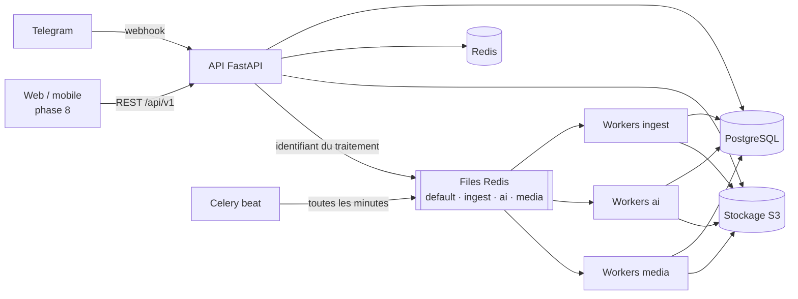
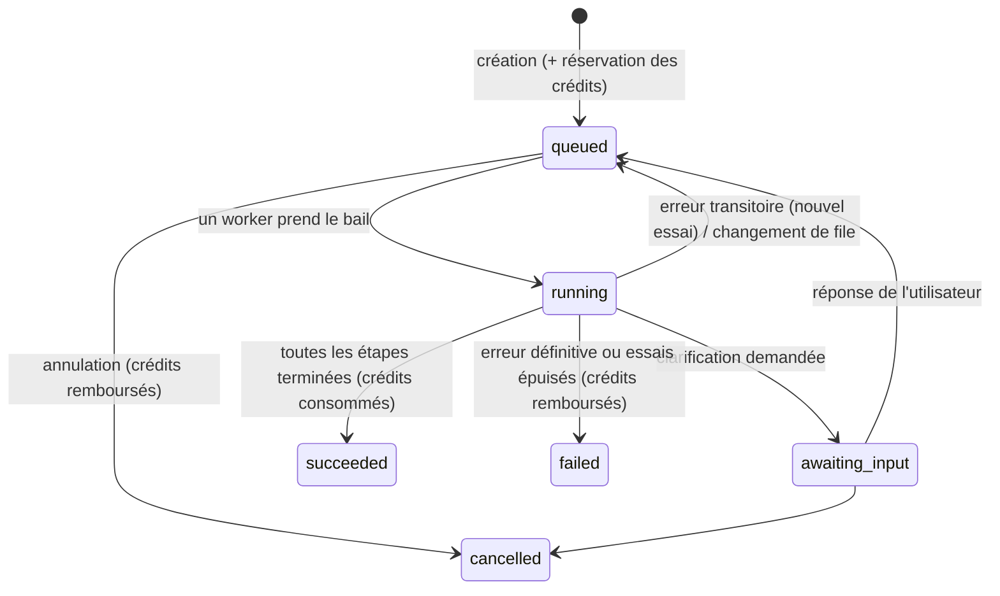

# Architecture

## Vue d'ensemble

Monolithe modulaire (une seule base de code, un seul déploiement) avec des **traitements
asynchrones séparés** exécutés par des workers. Chaque domaine métier est un module
(`src/edtech/modules/<domaine>`) avec ses modèles, ses services et ses routes ; les modules ne
communiquent que par leurs services, jamais en lisant les tables des autres. Cela permet d'extraire
un module en microservice le jour où la charge le justifie ([ADR 0001](adr/0001-monolithe-modulaire.md)).

| Composant | Rôle |
|---|---|
| API (`uvicorn`) | Webhook Telegram, API REST, validation, autorisations. Sans état : se met à l'échelle horizontalement. |
| Workers (`celery worker -Q …`) | Exécutent les étapes des traitements. Un groupe de workers par file, dimensionné indépendamment (le rendu vidéo n'affame pas l'OCR). |
| Beat (`celery beat`) | Tâches périodiques : récupération des traitements perdus (et, en phase 2, purge des documents expirés). **Une seule instance.** |
| PostgreSQL | Source de vérité : utilisateurs, crédits, traitements et leur journal, catalogue, audit. |
| Redis | Files de tâches, limites anti-abus, déduplication des mises à jour Telegram, état court du bot. Aucune donnée qu'on ne puisse perdre. |
| Stockage S3 | Documents envoyés, audio, vidéo, PDF générés. Seule la clé est en base. |

## Modules

| Module | Contenu |
|---|---|
| `users` | Comptes, identités externes (Telegram), profil scolaire, préférences, suppression (droit à l'effacement). |
| `auth` | Vérification des signatures Telegram, jetons d'accès (JWT 15 min) et de rafraîchissement (rotation, détection de réutilisation), rôles et permissions. |
| `credits` | Grand livre des crédits : attribution, réservation, consommation, remboursement ([ADR 0004](adr/0004-credits-grand-livre.md)). |
| `curriculum` | Paramètres par pays : programmes, classes, séries, matières, avec provenance et statut de validation. |
| `jobs` | Moteur de traitements : pipeline, états, journal, bail, essais, file de récupération. |
| `telegram` | Client de l'API Bot ([ADR 0003](adr/0003-client-telegram.md)), conversation, claviers. |
| `support` | Tickets d'assistance. |
| `audit` | Journal « qui a fait quoi » pour toute opération privilégiée ou touchant aux données personnelles. |

## Moteur de traitements

Le cahier des charges (§5) impose que chaque traitement ait un identifiant unique, un état et un
journal d'exécution. Implémentation : `modules/jobs`.

- **Pipeline** : un type de traitement (`correction`) est une liste ordonnée d'étapes ; chaque
  étape indique la file sur laquelle elle tourne (`ingest`, `ai`, `media`). Quand l'étape suivante
  appartient à une autre file, le traitement y est transféré.
- **Bail** : un worker doit détenir le bail pour exécuter une étape ou écrire un résultat. Un
  battement de cœur le prolonge pendant les étapes longues ; s'il est perdu, l'étape est annulée
  et rien n'est écrit. Les messages en double sont donc sans effet.
- **Reprise** : les étapes terminées sont enregistrées une par une ; un nouvel essai repart de la
  première étape non terminée. Les gestionnaires d'étape doivent être idempotents.
- **Erreurs** : `StageFailed` (définitive, ex. image illisible) → échec et remboursement ;
  `StageRetryable`, délai dépassé ou exception inattendue → nouvel essai avec délai exponentiel
  (10 s, 20 s, 40 s…), puis échec et remboursement ; `StageNeedsInput` → question à l'utilisateur.
- **Traçabilité** : chaque étape peut déclarer le fournisseur, le modèle et la version utilisés
  (`jobs.trace`) ; durées et événements sont dans `job_events`.
- **Récupération** : toutes les minutes, beat renvoie en file les traitements dont le message a été
  perdu ou dont le worker a disparu.

Étapes prévues du pipeline de correction (`CORRECTION_STAGES`) : réception, vérification du
fichier, prétraitement, extraction (OCR + multimodal), reconstruction de l'énoncé, identification
des questions, classification pédagogique, résolution, vérification indépendante, rédaction de la
correction, scénario, voix off, animations, assemblage, contrôle qualité, livraison. Elles sont
ajoutées phase par phase ; le pipeline n'est activé (`EDTECH_FEATURE_CORRECTIONS_ENABLED`) que
lorsqu'il est complet pour le mode choisi.

## Couche d'intelligence artificielle (phases 2 à 4)

Conception prévue, non encore implémentée :

- un **port par capacité** (`VisionExtractor`, `Solver`, `Verifier`, `SpeechSynthesizer`…) avec des
  adaptateurs par fournisseur, choisis par configuration ; aucun module métier n'importe un SDK de
  fournisseur directement ;
- sorties **structurées et validées** (schémas Pydantic) ; une sortie non conforme est une erreur
  d'étape, jamais un texte libre transmis à l'élève ;
- **vérification indépendante** : recalcul symbolique/numérique (SymPy, contrôle des unités) et
  second modèle distinct pour les raisonnements ; un désaccord bloque la livraison ou déclenche une
  révision humaine (rôle `reviewer`) ;
- chaque appel enregistre fournisseur, modèle, version, jetons et coût dans `jobs.trace`.

## Studio vidéo (phase 5)

Workers de la file `media` : Manim (animations scientifiques), Remotion (compositions), FFmpeg
(assemblage, encodage, sous-titres), fournisseur de voix interchangeable. Les rendus tournent dans
des processus isolés avec limites de durée et de mémoire.

## Choix transverses

- **Identifiants** UUID version 7 : uniques, non devinables, triés dans le temps (index compacts).
- **Erreurs HTTP** au format `application/problem+json` (RFC 9457) avec `code` stable et
  `request_id`.
- **Internationalisation** : tous les textes passent par `core/i18n.t()` ; un test garantit que
  chaque langue a les mêmes clés et les mêmes variables.
- **Données par pays** : fuseau horaire, devise et langues sont des paramètres du pays, pas du
  code. Les paramètres réglementaires et commerciaux (durée de conservation, crédits offerts) sont
  déclarés dans `countries.settings` et seront appliqués pays par pays à partir des phases 2 et 7 ;
  aujourd'hui, les crédits de bienvenue viennent de `EDTECH_SIGNUP_FREE_CREDITS`.
